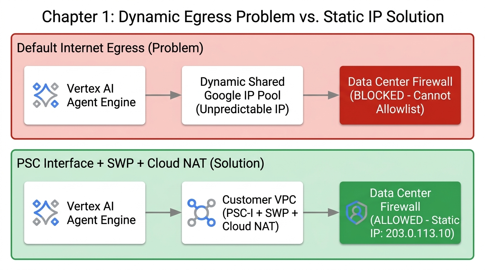
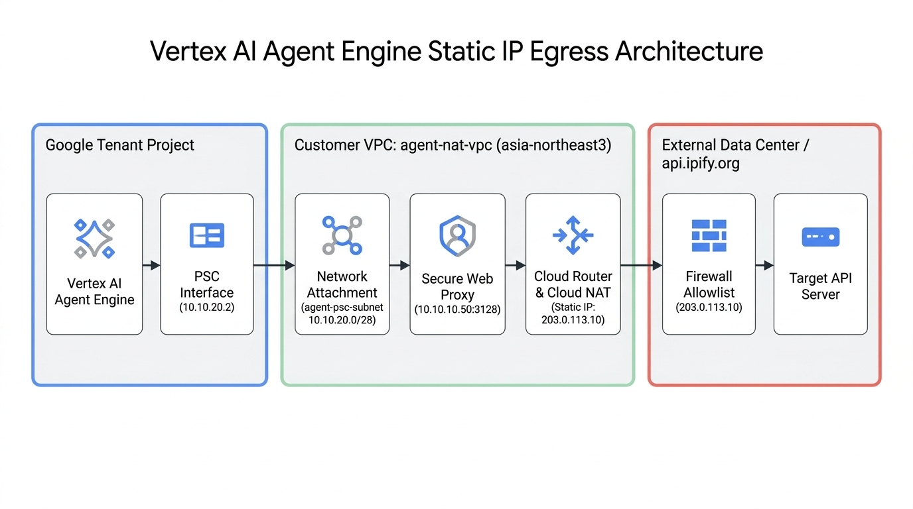
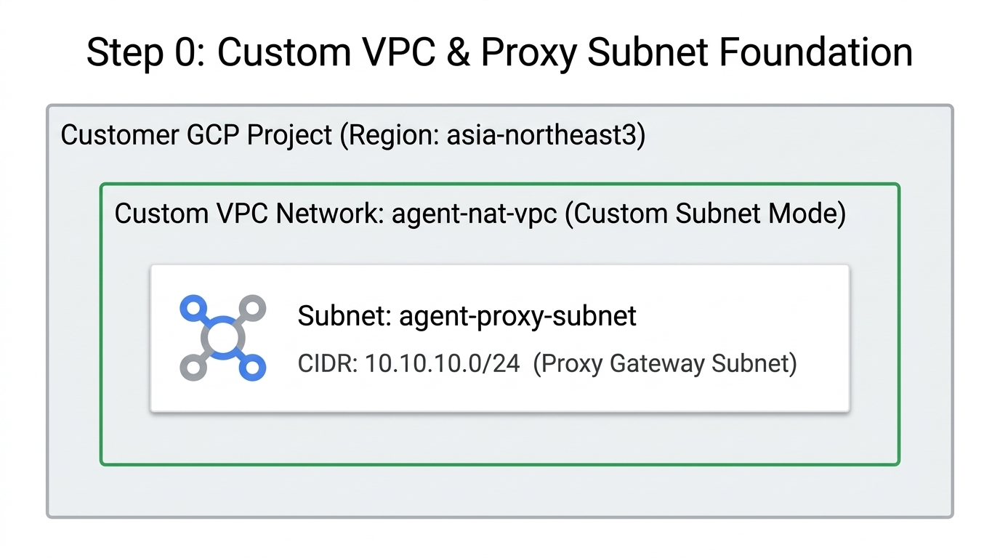
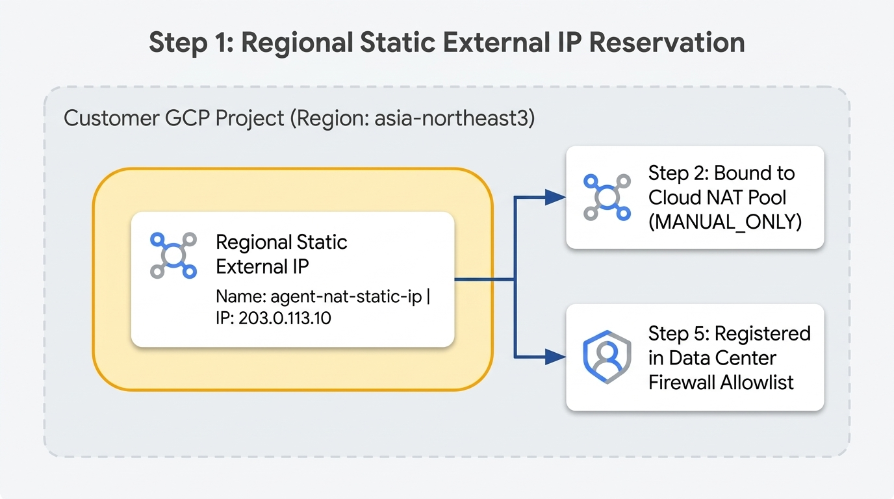
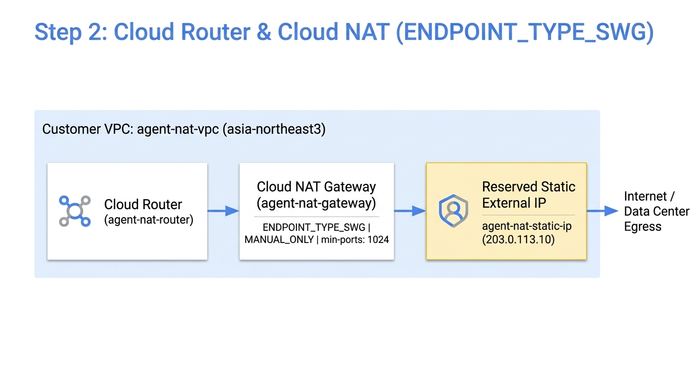
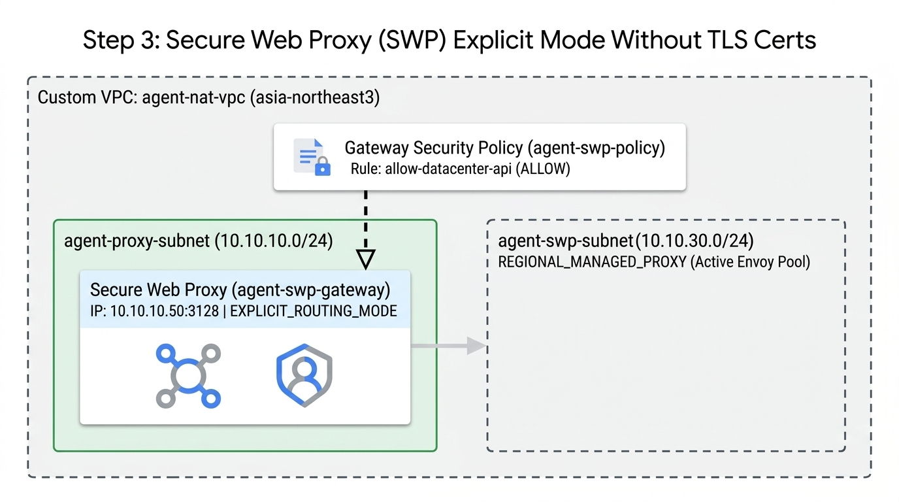
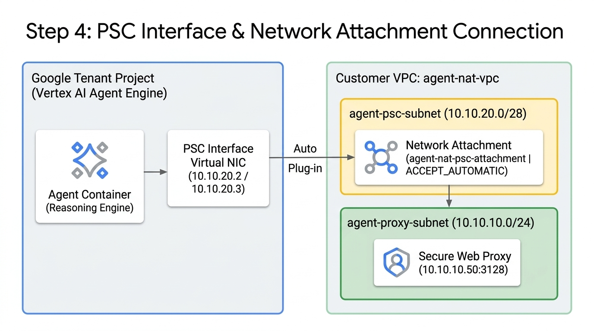
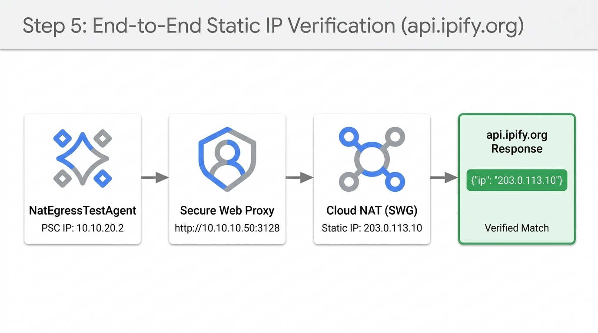
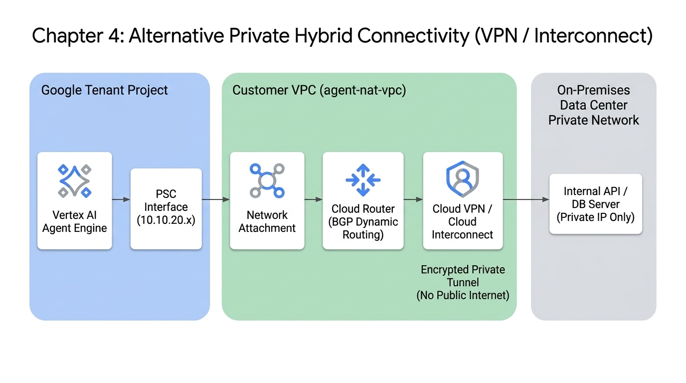

# Vertex AI Agent Engine 고정 공인 IP(Static Public IP) Egress 구축 가이드
**(PSC Interface + Secure Web Proxy + Cloud NAT 아키텍처)**

외부 데이터센터(온프레미스 레거시 시스템, 사내 DB, 프라이빗 API 서버 등)의 방화벽에서 특정 고정 공용 IP(Static Public IP)만 인바운드로 허용(Allowlist/화이트리스트)하도록 통제하는 경우, **Google-managed 테넌트의 기본 인터넷 Egress 대신 고객 VPC를 경유하는 Egress 아키텍처**를 구성해야 합니다.

---

### 1. 기본 구조에서 발생하는 문제와 해결 원리



* **기본 직접 Egress 사용 시 문제점**:
  * Agent Platform(또는 Vertex AI Agent Engine)의 기본 인터넷 Egress는 Google 내부 테넌트 풀의 공용 IP 대역을 동적으로 공유하여 나갑니다.
  * 이 대역은 IP가 유동적이고 Google Cloud 전체 사용자 대역과 겹치므로 데이터센터 방화벽에 단일 고정 IP로 등록할 수 없습니다.
* **해결 원리**:
  * 에이전트의 Egress 트래픽을 **PSC Interface (Private Service Connect Interface)**를 통해 고객사 VPC로 인입시킵니다.
  * 고객사 VPC 내부에 **Google Cloud Secure Web Proxy (SWP)**를 배치하고, 외부로 나가는 길목에 **Cloud NAT (Manual IP Allocation)**을 연결하여 **사전에 예약해 둔 고정 외부 IP(Static External IP, 예: `203.0.113.10`)**로 SNAT(Source Network Address Translation) 처리합니다.
  * 데이터센터 방화벽에는 이 예약된 Cloud NAT의 고정 공용 IP만 등록하면 됩니다.

---

### 2. 전체 네트워크 흐름 다이어그램



---

### 3. 단계별 구축 방법

#### 사전 준비: 공통 환경변수 설정 (최초 1회)
아래 명령어의 `your-gcp-project-id`와 `gs://your-staging-bucket`만 고객사 환경에 맞게 수정하여 터미널에 선언해 두면, **0단계부터 5단계까지의 모든 명령어를 별도 수정 없이 그대로 복사·붙여넣기하여 실행**할 수 있습니다.

```bash
# 1. 고객사 GCP 프로젝트 ID, 리전, 스테이징 GCS 버킷 설정
export PROJECT_ID="your-gcp-project-id"
export REGION="asia-northeast3"
export STAGING_BUCKET="gs://your-staging-bucket"

# 2. gcloud 기본 프로젝트 설정 및 프로젝트 번호 자동 조회
gcloud config set project $PROJECT_ID
export PROJECT_NUMBER=$(gcloud projects describe $PROJECT_ID --format="value(projectNumber)")
echo "Project ID: $PROJECT_ID / Project Number: $PROJECT_NUMBER / Region: $REGION"
```

---

#### 0단계: 에이전트 NAT 전용 VPC(`agent-nat-vpc`) 및 프록시 서브넷(`agent-proxy-subnet`) 생성



기존에 사용 중인 VPC가 없다면 아래 명령어로 에이전트 외부 통신을 위한 커스텀 VPC(`agent-nat-vpc`)와 프록시를 배치할 기본 사설 서브넷(`agent-proxy-subnet`)을 먼저 생성합니다.

> **💡 참고**: 프로젝트 내 기존 VPC 목록을 먼저 확인하려면 `gcloud compute networks list` 명령어를 실행하세요. 만약 기존 VPC를 그대로 사용하려면 이후 단계의 `--network=agent-nat-vpc`를 기존 VPC 이름으로 변경하여 실행하면 됩니다.

```bash
# 1. 기존 VPC 네트워크 목록 확인
gcloud compute networks list --project=$PROJECT_ID

# 2. 에이전트 NAT 전용 VPC 네트워크(agent-nat-vpc) 생성 (커스텀 서브넷 모드)
gcloud compute networks create agent-nat-vpc \
    --project=$PROJECT_ID \
    --subnet-mode=custom

# 3. 프록시 배치 및 Cloud NAT 대상이 될 서브넷(agent-proxy-subnet) 생성
gcloud compute networks subnets create agent-proxy-subnet \
    --project=$PROJECT_ID \
    --network=agent-nat-vpc \
    --region=$REGION \
    --range=10.10.10.0/24
```

---

#### 1단계: 고정 외부 IP 주소 예약 (Static External IP)



Cloud NAT 게이트웨이에 바인딩할 리전 단위 고정 외부 IP(`agent-nat-static-ip`)를 예약합니다.

> **⚠️ 주의**: 동일한 리전 내에 기존 이름(`agent-nat-static-ip`)과 중복되는 IP 리소스가 있으면 생성 시 오류(`already exists`)가 발생합니다. 생성 전 아래 명령어로 기존에 생성된 IP가 있는지 먼저 확인하세요.

```bash
# 1. 리전 내 전체 고정 IP 목록 확인
gcloud compute addresses list --regions=$REGION --project=$PROJECT_ID

# 2. 리전별 정적 외부 IP(agent-nat-static-ip) 생성
gcloud compute addresses create agent-nat-static-ip \
    --region=$REGION \
    --project=$PROJECT_ID

# 3. 생성된 고정 외부 IP 주소 및 상태(RESERVED) 확인
gcloud compute addresses describe agent-nat-static-ip \
    --region=$REGION \
    --project=$PROJECT_ID
```

---

#### 2단계: Cloud Router 및 SWP 전용 Cloud NAT (Manual Allocation) 구성



자동 IP 할당(`--auto-allocate-nat-external-ips`) 대신 **수동 IP 할당 모드**를 지정하여 1단계에서 예약한 고정 IP(`agent-nat-static-ip`)를 등록합니다.

> **⚠️ 핵심 주의 (`--endpoint-types=ENDPOINT_TYPE_SWG` 및 `--min-ports-per-vm=1024`)**:
> 1. Cloud NAT의 기본 엔드포인트 타입은 일반 VM용(`ENDPOINT_TYPE_VM`)입니다. **Secure Web Proxy(SWP)**에서 나가는 트래픽을 고정 IP로 SNAT 처리하려면 반드시 **`--endpoint-types=ENDPOINT_TYPE_SWG`** 옵션을 명시해야 합니다.
> 2. SWP는 내부적으로 여러 대의 관리형 Envoy 프록시 인스턴스를 실행하며, SWP용 Cloud NAT의 기본 `min-ports-per-vm` 값(32,768)을 그대로 두면 단일 고정 IP(총 64,512 포트)로 1대의 Envoy에만 포트가 할당되어 타임아웃이 발생할 수 있습니다. 반드시 **`--min-ports-per-vm=1024`**를 함께 지정하여 모든 SWP 인스턴스에 NAT 포트가 고르게 분배(`minExtraNatIpsNeeded: 0`)되도록 설정하세요.
> 3. 만약 3단계(SWP 배포)를 먼저 실행한 경우, GCP가 자동으로 `swg-autogen-router-*` 및 `swg-autogen-nat`를 생성합니다. 이 경우 아래 `2-B` 명령어로 자동 생성된 `swg-autogen-nat`에 고정 IP와 `--min-ports-per-vm=1024`를 업데이트하면 됩니다.

```bash
# 1. 기존 Cloud Router 목록 확인
gcloud compute routers list --regions=$REGION --project=$PROJECT_ID

# 2-A. 직접 Cloud Router 및 SWP 전용 Cloud NAT를 먼저 생성하는 경우
gcloud compute routers create agent-nat-router \
    --project=$PROJECT_ID \
    --network=agent-nat-vpc \
    --region=$REGION

gcloud compute routers nats create agent-nat-gateway \
    --project=$PROJECT_ID \
    --router=agent-nat-router \
    --region=$REGION \
    --endpoint-types=ENDPOINT_TYPE_SWG \
    --nat-all-subnet-ip-ranges \
    --nat-external-ip-pool=agent-nat-static-ip \
    --min-ports-per-vm=1024

# 2-B. (참고: 3단계 SWP를 먼저 배포하여 swg-autogen-nat가 자동 생성된 경우)
# export SWG_ROUTER=$(gcloud compute routers list --project=$PROJECT_ID --filter="network:agent-nat-vpc AND name~^swg-autogen-router" --format="value(name)")
# gcloud compute routers nats update swg-autogen-nat \
#     --project=$PROJECT_ID \
#     --router=$SWG_ROUTER \
#     --region=$REGION \
#     --nat-external-ip-pool=agent-nat-static-ip \
#     --min-ports-per-vm=1024

# 3. 생성된 Cloud NAT 상태 확인 (ENDPOINT_TYPE_SWG 확인)
gcloud compute routers nats list \
    --project=$PROJECT_ID \
    --router=agent-nat-router \
    --region=$REGION
```

---

#### 3단계: 고객 VPC에 프록시(Forward Proxy) 구성 - Google Cloud Secure Web Proxy (SWP 무인증서 모드)



에이전트가 PSC Interface를 통해 도구 호출을 수행할 때, 공용 인터넷 목적지 도메인(`https://api.datacenter.com`)을 안전하게 처리할 완전 관리형 **Google Cloud Secure Web Proxy (SWP)**를 VPC 서브넷(`agent-proxy-subnet`)에 배치합니다.

> **💡 핵심 포인트 (TLS 인증서 없이 SWP 배포하기)**:
> SWP 게이트웨이 YAML 작성 시 불필요한 `scope` 필드와 `certificateUrls` 필드를 제외하고 `routingMode: EXPLICIT_ROUTING_MODE`로 지정하면, **별도의 TLS 인증서 생성/등록 없이도 표준 HTTP CONNECT 프록시(`http://10.10.10.50:3128`)로 즉시 배포**할 수 있습니다.

##### 📊 Secure Web Proxy (SWP) 특징 및 장점

| 구분 | 내용 |
| :--- | :--- |
| **추천 용도** | **실제 상용 운영 (Production) 및 엔터프라이즈 환경 표준** |
| **장점 (Pros)** | • **완전 관리형(Serverless)**: 구글이 고가용성(HA)과 오토스케일링을 자동으로 보장 (단일 VM 장애 위험 없음)<br>• **TLS 인증서 관리 불필요**: `scope` 및 `certificateUrls`를 생략하여 사설 인증서 발급/갱신 부담 없이 즉시 `http://10.10.10.50:3128`로 구성 가능<br>• **세밀한 보안 통제**: 오픈 프록시 위험 없이 도메인(SNI/Host) 기반 정책(`GatewaySecurityPolicy`)으로 안전하게 제어 |
| **단점 (Cons)** | • 시간당 게이트웨이 기본 비용 및 트래픽 처리 비용 발생 |

##### 🔹 단계별 가이드: Google Cloud Secure Web Proxy (SWP) 무인증서 구성

0. **필수 GCP API 2종 활성화 (최초 1회)**
   SWP 게이트웨이와 보안 정책 관리를 위해 필요한 API를 활성화합니다.
   ```bash
   gcloud services enable \
       networkservices.googleapis.com \
       networksecurity.googleapis.com \
       --project=$PROJECT_ID
   ```

1. **프록시 전용 서브넷(`agent-swp-subnet`, `REGIONAL_MANAGED_PROXY`) 생성**
   SWP(Secure Web Proxy)가 내부적으로 사용할 리전 프록시 전용 서브넷(최소 `/26` 이상 권장, 여기서는 `/24`)을 생성하고 확인합니다.
   ```bash
   # 프록시 전용 서브넷 생성
   gcloud compute networks subnets create agent-swp-subnet \
       --project=$PROJECT_ID \
       --network=agent-nat-vpc \
       --region=$REGION \
       --range=10.10.30.0/24 \
       --purpose=REGIONAL_MANAGED_PROXY \
       --role=ACTIVE

   # 생성된 서브넷 목록 확인 (agent-proxy-subnet, agent-swp-subnet 확인)
   gcloud compute networks subnets list \
       --project=$PROJECT_ID \
       --network=agent-nat-vpc \
       --regions=$REGION
   ```

2. **Gateway 보안 정책(`agent-swp-policy`) 및 허용 규칙(`allow-datacenter-api`) 생성**
   `gateway-security-policies import` 명령어를 사용하여 보안 정책과 도메인 허용 규칙을 생성합니다.
   ```bash
   # 1. 보안 정책(agent-swp-policy) 생성
   gcloud network-security gateway-security-policies import agent-swp-policy \
       --project=$PROJECT_ID \
       --location=$REGION \
       --source=- <<EOF
   name: projects/${PROJECT_ID}/locations/${REGION}/gatewaySecurityPolicies/agent-swp-policy
   description: Agent SWP Security Policy
   EOF

   # 2-A. [테스트/검증용 기본] 외부 호스트 호출 허용 규칙 생성
   gcloud network-security gateway-security-policies rules import allow-datacenter-api \
       --project=$PROJECT_ID \
       --gateway-security-policy=agent-swp-policy \
       --location=$REGION \
       --source=- <<EOF
   name: projects/${PROJECT_ID}/locations/${REGION}/gatewaySecurityPolicies/agent-swp-policy/rules/allow-datacenter-api
   basicProfile: ALLOW
   enabled: true
   priority: 100
   sessionMatcher: "host() != ''"
   EOF

   # 2-B. [실무 운영 권장] 특정 데이터센터 도메인만 허용하려면 sessionMatcher를 아래와 같이 지정합니다:
   # sessionMatcher: "host() == 'api.datacenter.com' || host() == 'api.ipify.org'"

   # 3. 생성된 보안 정책 및 규칙 목록 확인
   gcloud network-security gateway-security-policies list \
       --project=$PROJECT_ID \
       --location=$REGION
   gcloud network-security gateway-security-policies rules list \
       --project=$PROJECT_ID \
       --gateway-security-policy=agent-swp-policy \
       --location=$REGION
   ```

3. **Secure Web Proxy 게이트웨이(`agent-swp-gateway`) 무인증서 배포 (`EXPLICIT_ROUTING_MODE`)**
   `scope`와 `certificateUrls`를 제외하고 `routingMode: EXPLICIT_ROUTING_MODE`를 지정하여 사설 IP(`10.10.10.50`)와 포트(`3128`)로 SWP 인스턴스를 배포합니다.
   ```bash
   # SWP 게이트웨이 배포 (인증서 없이 배포, 약 30초 소요)
   gcloud network-services gateways import agent-swp-gateway \
       --project=$PROJECT_ID \
       --location=$REGION \
       --source=- <<EOF
   name: projects/${PROJECT_ID}/locations/${REGION}/gateways/agent-swp-gateway
   type: SECURE_WEB_GATEWAY
   addresses: ["10.10.10.50"]
   ports: [3128]
   routingMode: EXPLICIT_ROUTING_MODE
   gatewaySecurityPolicy: projects/${PROJECT_ID}/locations/${REGION}/gatewaySecurityPolicies/agent-swp-policy
   network: projects/${PROJECT_ID}/global/networks/agent-nat-vpc
   subnetwork: projects/${PROJECT_ID}/regions/${REGION}/subnetworks/agent-proxy-subnet
   EOF

   # 배포된 SWP 게이트웨이 목록 및 상태 확인
   gcloud network-services gateways list \
       --project=$PROJECT_ID \
       --location=$REGION
   ```

---

#### 4단계: PSC Interface (Network Attachment) 연결



에이전트(Google 관리형 테넌트 프로젝트에서 실행됨)가 고객 VPC(`agent-nat-vpc`) 내부로 직접 들어올 수 있도록 **"가상 랜선 콘센트"** 역할을 하는 전용 서브넷(`agent-psc-subnet`)과 **Network Attachment(`agent-nat-psc-attachment`)**를 생성합니다.

* **핵심 역할 요약**:
  1. **`agent-psc-subnet` (`10.10.20.0/28`)**: 구글 관리형 영역에 있는 에이전트에게 빌려줄 사설 IP 묶음(풀)입니다.
  2. **`agent-nat-psc-attachment` (`Network Attachment`)**: 에이전트가 고객 VPC(`agent-nat-vpc`)에 가상 랜선(NIC)을 꽂을 수 있게 해주는 **연결 포트(콘센트)**입니다. `--connection-preference=ACCEPT_AUTOMATIC`으로 설정하여 에이전트 배포 시 별도 수동 승인 없이 즉시 연결됩니다.
  3. **연결 후 효과**: 에이전트가 `10.10.20.x` IP를 달고 고객 VPC 내부 일원처럼 동작하므로, 3단계에서 만든 **`agent-swp-gateway` (`http://10.10.10.50:3128`)**와 내부 사설망으로 직접 통신할 수 있게 됩니다.

```bash
# 1. PSC Interface 전용 서브넷(agent-psc-subnet) 생성
gcloud compute networks subnets create agent-psc-subnet \
    --project=$PROJECT_ID \
    --network=agent-nat-vpc \
    --region=$REGION \
    --range=10.10.20.0/28

# 2. Network Attachment(agent-nat-psc-attachment) 생성
gcloud compute network-attachments create agent-nat-psc-attachment \
    --project=$PROJECT_ID \
    --region=$REGION \
    --subnets=agent-psc-subnet \
    --connection-preference=ACCEPT_AUTOMATIC

# 3. 생성된 Network Attachment 확인
gcloud compute network-attachments list \
    --project=$PROJECT_ID \
    --regions=$REGION
```

---

#### 5단계: 데이터센터 방화벽 화이트리스트 등록 및 고정 IP(`api.ipify.org`) 검증



실제 운영 환경에서는 1단계에서 예약한 고정 외부 IP(`agent-nat-static-ip`, 예: `203.0.113.10`)를 데이터센터 인바운드 방화벽(WAF/보안장비)에 **Source IP**로 허용 등록합니다.

연동 전 또는 별도의 데이터센터 테스트 서버가 없는 환경에서는, 요청자의 공인 IP를 그대로 반환해 주는 공개 API(**`https://api.ipify.org?format=json`**)를 호출하는 에이전트를 배포하여 **에이전트의 외부 진출(Egress) IP가 예약한 고정 외부 IP와 정확히 일치하는지 검증**합니다.

##### 5-1. 예약된 고정 공인 IP 확인 및 Vertex AI 서비스 에이전트 IAM 권한 부여 (최초 1회)
Vertex AI Reasoning Engine 서비스 에이전트가 `agent-nat-psc-attachment`에 네트워크 인터페이스를 연결할 수 있도록 `compute.networkAdmin` 및 `dns.peer` 권한을 부여합니다.

```bash
# 1. 예약한 고정 공인 IP 확인 (이 IP를 데이터센터 방화벽 화이트리스트에 등록)
export STATIC_NAT_IP=$(gcloud compute addresses describe agent-nat-static-ip \
    --region=$REGION \
    --project=$PROJECT_ID \
    --format="value(address)")
echo "데이터센터 방화벽에 등록할 고정 공인 IP: $STATIC_NAT_IP"

# 2. Vertex AI 서비스 에이전트 생성 확인 (최초 1회)
gcloud beta services identity create \
    --service=aiplatform.googleapis.com \
    --project=$PROJECT_ID

# 3. Vertex AI Reasoning Engine 서비스 에이전트에 네트워크 및 DNS 권한 부여
gcloud projects add-iam-policy-binding $PROJECT_ID \
    --member="serviceAccount:service-${PROJECT_NUMBER}@gcp-sa-aiplatform-re.iam.gserviceaccount.com" \
    --role="roles/compute.networkAdmin"

gcloud projects add-iam-policy-binding $PROJECT_ID \
    --member="serviceAccount:service-${PROJECT_NUMBER}@gcp-sa-aiplatform-re.iam.gserviceaccount.com" \
    --role="roles/dns.peer"
```

##### 5-2. 에이전트에 적용해야 할 설정/코드 변경 사항 및 배포 검증

기존 에이전트가 우리가 구축한 **PSC Interface + Secure Web Proxy(`http://10.10.10.50:3128`)**를 경유하여 고정 공인 IP로 나가도록 하려면 딱 **2가지 설정**이 필요합니다.

1. **배포 시 네트워크 연결 설정 (`psc_interface_config`)**:
   * `agent_engines.create()` 호출 시 `psc_interface_config`에 4단계에서 만든 `agent-nat-psc-attachment`를 지정합니다.
   * 이 설정이 들어가야 Google 관리형 영역의 에이전트 컨테이너에 `10.10.20.x` 대역의 가상 NIC가 연결되어 고객 VPC 내부의 사설 IP인 `10.10.10.50:3128`(SWP)과 통신할 수 있습니다.
2. **에이전트 외부 호출 시 프록시 주소(`http://10.10.10.50:3128`) 지정**:
   * **이유**: PSC Interface는 기본적으로 **사설 IP(`10.x.x.x` 등)로 향하는 트래픽만 고객 VPC로 라우팅**합니다. 프록시 지정 없이 공인 도메인(`https://api.ipify.org`, 외부 데이터센터 공인 IP 등)을 그냥 호출하면 PSC Interface를 타지 않고 Google 기본 인터넷 망으로 나가게 됩니다.
   * 따라서 아래 **방법 A(코드 내 지정)** 또는 **방법 B(코드 수정 없이 환경변수로 일괄 지정)** 중 하나를 선택하여 트래픽이 먼저 SWP 사설 IP(`10.10.10.50:3128`)로 향하도록 구성합니다.

###### 🔹 방법 A: 외부 호출 도구(Tool) 코드에 명시적으로 프록시 지정 및 검증 스크립트(`verify_egress_ip.py`) 실행
특정 외부 데이터센터 API 호출 함수에만 프록시를 적용하고 싶을 때 사용하는 방식입니다. (`requests` 사용 시 `requests.get(url, proxies={"https": SWP_PROXY_URL})`, `httpx` 사용 시 `httpx.Client(proxy=SWP_PROXY_URL)`로 동일하게 적용 가능합니다.)

리포지토리에 포함된 `verify_egress_ip.py`를 바로 실행하거나 아래 Python 코드를 실행하여 검증할 수 있습니다.

```bash
# 필수 패키지 설치 및 검증 스크립트 실행
pip install "google-cloud-aiplatform[agent_engines]>=1.70.0" cloudpickle
python3 verify_egress_ip.py
```

```python
import os
import urllib.request
import vertexai
from vertexai import agent_engines
from google.cloud import aiplatform_v1

PROJECT_ID = os.environ["PROJECT_ID"]
LOCATION = os.environ.get("REGION", "asia-northeast3")
STAGING_BUCKET = os.environ["STAGING_BUCKET"]
NETWORK_ATTACHMENT = f"projects/{PROJECT_ID}/regions/{LOCATION}/networkAttachments/agent-nat-psc-attachment"
SWP_PROXY_URL = "http://10.10.10.50:3128"

vertexai.init(project=PROJECT_ID, location=LOCATION, staging_bucket=STAGING_BUCKET)

class NatEgressTestAgent:
    def query(self, question: str = "check") -> dict:
        # [핵심 2] HTTP 클라이언트에 SWP 사설 IP:포트(10.10.10.50:3128)를 프록시로 등록
        proxy_handler = urllib.request.ProxyHandler({
            "http": SWP_PROXY_URL,
            "https": SWP_PROXY_URL,
        })
        opener = urllib.request.build_opener(proxy_handler)
        with opener.open("https://api.ipify.org?format=json", timeout=10) as response:
            ip_data = response.read().decode("utf-8").strip()
        return {
            "question": question,
            "swp_proxy_used": SWP_PROXY_URL,
            "detected_egress_public_ip": ip_data,
        }

# 1. [핵심 1] PSC Interface(agent-nat-psc-attachment)를 연결하여 에이전트 배포
remote_agent = agent_engines.create(
    agent_engine=NatEgressTestAgent(),
    display_name="agent-nat-swp-verify-agent",
    description="Agent Engine Egress Fixed IP Verification via SWP and Cloud NAT",
    requirements=[],
    psc_interface_config=aiplatform_v1.PscInterfaceConfig(
        network_attachment=NETWORK_ATTACHMENT
    ),
)

print("배포 완료 리소스명:", remote_agent.resource_name)

# 2. 배포된 에이전트 호출 테스트 (detected_egress_public_ip가 STATIC_NAT_IP와 일치하는지 확인)
result = remote_agent.query(question="현재 에이전트가 외부로 나가는 공인 IP가 무엇인가요?")
print("검증 결과:", result)
```

###### 🔹 방법 B: 기존 에이전트 코드 수정 없이 배포 환경변수(`env_vars`)로 일괄 적용 (실무 권장 팁)
이미 작성된 에이전트의 Python 도구 코드를 수정하기 어렵다면, Python 표준 HTTP 라이브러리(`requests`, `urllib`, `httpx` 등)가 자동으로 인식하는 `HTTP_PROXY` / `HTTPS_PROXY` 환경변수를 배포 시점(`env_vars`)에 주입하여 **코드 한 줄 수정 없이** 프록시를 경유하게 할 수 있습니다.

> **⚠️ 주의 (`NO_PROXY` 필수 지정)**: Gemini 모델 호출 등 Google Cloud 내부 API(`*.googleapis.com`)는 SWP 프록시를 타지 않도록 반드시 `NO_PROXY`에 예외 도메인을 함께 등록하세요.

```python
remote_agent = agent_engines.create(
    agent_engine=my_existing_agent,  # 기존 에이전트 코드 그대로 사용
    display_name="my-production-agent",
    psc_interface_config=aiplatform_v1.PscInterfaceConfig(
        network_attachment=NETWORK_ATTACHMENT
    ),
    env_vars={
        "HTTP_PROXY": "http://10.10.10.50:3128",
        "HTTPS_PROXY": "http://10.10.10.50:3128",
        "NO_PROXY": "localhost,127.0.0.1,169.254.169.254,.googleapis.com,.google.com",
    },
)
```

##### 5-3. 정상 배포 및 검증 확인 방법

1. **Network Attachment (`agent-nat-psc-attachment`) 자동 연결 상태 확인**:
   ```bash
   gcloud compute network-attachments describe agent-nat-psc-attachment \
       --region=$REGION \
       --project=$PROJECT_ID
   ```
   출력 결과의 `connectionEndpoints` 항목에 `10.10.20.2` 등의 IP가 `status: ACCEPTED`로 표시되면 정상 연결된 것입니다.

2. **에이전트 쿼리(`api.ipify.org`) 응답 결과 확인**:
   ```json
   {
     "question": "현재 에이전트가 외부로 나가는 공인 IP가 무엇인가요?",
     "swp_proxy_used": "http://10.10.10.50:3128",
     "detected_egress_public_ip": "{\"ip\":\"203.0.113.10\"}"
   }
   ```
   `detected_egress_public_ip` 값이 1단계에서 예약한 `STATIC_NAT_IP`(예: `203.0.113.10`)와 일치하면 전체 구간(`Agent Engine` $\rightarrow$ `PSC Interface` $\rightarrow$ `SWP (10.10.10.50:3128)` $\rightarrow$ `Cloud NAT 고정 IP`)이 정상 동작하는 것입니다.

---

### 4. 대안: 전용선/VPN을 통한 사설망(Private) 연동 (권장 검토)



만약 데이터센터가 이미 GCP와 **Cloud Interconnect(전용선)** 또는 **Cloud VPN**으로 연결되어 있다면, 트래픽을 굳이 공용 인터넷으로 돌리지 않고 **내부 사설 IP로 직접 통신**하는 것이 보안 및 지연시간 측면에서 훨씬 유리합니다.

* **동작 방식**: 
  $$\text{Agent Platform} \xrightarrow{\text{PSC-I}} \text{고객 VPC} \xrightarrow{\text{Cloud Router (BGP)}} \xrightarrow{\text{VPN / Interconnect}} \text{데이터센터 사설망}$$
* **장점**: 공용 인터넷 구간을 타지 않으므로 데이터 암호화 터널 내부에서만 안전하게 흐르며, 공용 IP 노출이나 디도스 위험 없이 데이터센터 내부 방화벽의 사설 IP 대역 허용만으로 해결됩니다.

---

### 5. 핵심 요약
1. **가능 여부**: 완벽하게 가능합니다.
2. **핵심 방식**: **PSC Interface (`agent-nat-psc-attachment`)**로 Agent 트래픽을 고객 VPC(`agent-nat-vpc`)로 유입 $\rightarrow$ **Secure Web Proxy (`10.10.10.50:3128`)** 경유 $\rightarrow$ **Cloud NAT (수동 할당 모드, `ENDPOINT_TYPE_SWG`)**를 통해 사전에 확보한 **고정 공용 IP (`agent-nat-static-ip`)**로 변환되어 데이터센터로 전송됩니다.
3. **작업 포인트**: GCP 측에서 예약한 리전 고정 IP 주소를 데이터센터 네트워크 보안팀에 전달하여 인바운드 ACL(화이트리스트)에 등록하시면 됩니다.
